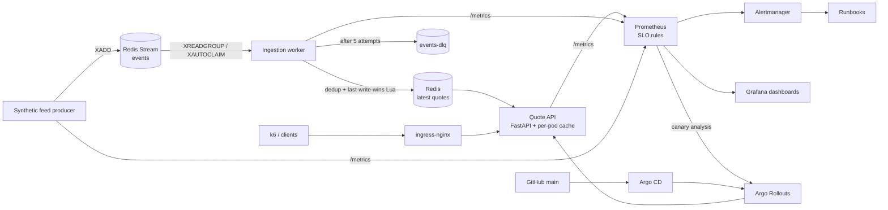

# MarketPulse

**An SLO-driven reliability platform for a synthetic market-data service.**

MarketPulse simulates a market-data service: a producer publishes synthetic price events, an
ingestion worker turns them into latest quotes, and a FastAPI service serves those quotes with
their age. The application is deliberately small. The subject of the project is **reliability**:
defining what "healthy" means for market data, detecting when it isn't, releasing safely,
breaking things on purpose, and recovering with evidence.

All data is synthetic. Nothing connects to an exchange or handles real money.

> Status: built and validated locally (Docker Compose and a 3-node kind cluster). The AWS/EKS
> phase in the [spec](docs/SPEC.md) is not built yet.

## What is different here

| Typical project | MarketPulse |
|---|---|
| Uptime / HTTP 200 checks | Domain SLIs: **quote freshness** and **ingestion lag**, plus availability and latency |
| Static threshold alerts | **Multi-window, multi-burn-rate** SLO alerts, unit-tested with `promtool` |
| Manual rollback | **Canary releases** with Argo Rollouts and Prometheus analysis; automatic abort |
| Kill a pod, watch it restart | Dependency outage, poison messages, 10× market-open burst, slow worker drills with measured detection and recovery |
| "Monitoring set up" | Runbook per alert, blameless postmortems from real drill data |

## Architecture



- **Degraded mode:** if Redis fails or is slower than 50 ms, each API pod serves its cached quote
  for at most 30 s (`stale: true`), then answers `503 QUOTE_UNAVAILABLE` with `Retry-After`. It
  never serves an arbitrarily old price. Readiness deliberately ignores Redis
  ([why](docs/slos.md#degraded-mode-and-its-limitations)).
- **Ingestion:** at-least-once delivery; dedup on `event_id`; an older event never overwrites a
  newer quote; bounded retries, then dead-letter queue.
- **Queue backends:** Redis Streams locally; SQS implementation behind the same `QueueBackend`
  interface (tested with `moto` only).
- **Fault injection** built in: error rate, extra latency, readiness failure, worker failure rate
  and latency ([configuration](docs/configuration.md#fault-injection-section-07-of-the-spec)).

## Quick start

Prerequisites: Docker, kind, kubectl, Helm, k6, uv, Python 3.13+, GNU make, bash.

```bash
make setup          # Python deps
make test lint      # unit tests (coverage ≥ 80 %), ruff, mypy --strict, shellcheck, helm/kubeconform
make rules-test     # promtool check + unit tests for every SLO and alert rule
```

**Docker Compose** (API on :18000, Grafana on :13000, Prometheus on :19090, Alertmanager on :19093):

```bash
make up             # build + start everything, wait until healthy
make smoke          # health, end-to-end event → quote within 5 s, /metrics
make load           # k6 steady load (50 req/s, 10 min)
make down
```

**kind** (3 nodes, Calico, ingress on 127.0.0.1:18080 with `Host: marketpulse.localtest.me`):

```bash
make kind-up        # cluster + Calico + metrics-server + ingress-nginx + kube-prometheus-stack
make deploy-local   # build image, kind load, deploy chart
make gitops-up      # Argo CD + Argo Rollouts; the app then syncs from GitHub main
make smoke TARGET=kind
make drill N=4      # run a reliability experiment (1-6, 8)
make kind-down
```

## Results

Every number below was measured on this machine on 2026-10-26 (Windows 11, Docker Desktop, 8 vCPU /
10 GB VM shared with other workloads). Raw evidence lives in
[docs/experiments/evidence/](docs/experiments/evidence/); per-run write-ups in [docs/experiments/](docs/experiments/).

| What | Measured | Source |
|---|---|---|
| `AvailabilityFastBurn` on `FAULT_API_ERROR_RATE=0.2` under 50 req/s (compose) | fired **15 s** after the fault (fresh stack, ~2 min of history); resolved **29 m 14 s** after clearing (held by the 6h/30m pair) | [PROGRESS M3](docs/PROGRESS.md) |
| `IngestionStalled` when the worker is stopped | fired **2 m 19 s** after stop (`for: 2m`); resolved **21 s** after restart | [PROGRESS M3](docs/PROGRESS.md) |
| API HPA under 400 req/s (kind) | 2 → 3 replicas **42 s** after load start, 6 at 53 s; back to 2 **113 s** after load stopped | [PROGRESS M4](docs/PROGRESS.md), `evidence/m4-hpa.txt` |
| Graceful API pod delete under load, 2 replicas | 1,901 requests, **0** failed | `evidence/m4-pod-delete-k6-summary.json` |
| Argo CD drift (manual `scale redis=2`) | self-healed to 1 within **~4 min** (60 s reconcile + self-heal backoff) | `evidence/m5-drift.json` |
| Good release through the canary (10 % → 50 % → 100 %) | promoted **18 m 26 s** after push; both analyses `Successful` | `evidence/canary-good-*` |
| Bad release (20 % 5xx) through the canary | analysis `Failed` on its first sample; **3.265 s** from failure to 100 % stable; reverted in Git | [experiment 3](docs/experiments/3-bad-deploy.md), [postmortem](docs/incidents/2026-10-26-bad-release-canary-abort.md) |
| Canary with **no traffic** | not promoted: analysis `Failed` with empty results, aborted in **314 ms** | `evidence/canary-no-traffic-*` |
| Drill 1 — force-kill API pods (SIGKILL, no drain), 30 req/s | replaced in **6 s** and **7 s**; **0** 5xx, SLI 0, no alert — but **51 / 7,277** client requests hit connection resets the API-side SLI cannot see | [experiment 1](docs/experiments/1-kill-api-pods.md) |
| Drill 2 — pod failing readiness | never Ready, **0** endpoints, **0** requests served, 0 restarts; 7,301 requests, **0** failed | [experiment 2](docs/experiments/2-fail-readiness.md) |
| Drill 6 — 20 poison messages | all dead-lettered in **9 s** (5 attempts each); DLQ alert **76 s** after publish; worker kept processing (2,200 good events, 0 restarts) | [experiment 6](docs/experiments/6-poison-messages.md) |
| Drill 5 — market-open burst: 30 → 300 req/s and 20 → 200 events/s for 5 min | API HPA 2 → 6 (first decision **37 s**, full **89 s**), worker 2 → 4; queue peak **347**, lag p99 peak **1.90 s**, drained **7 s** after the burst; p99 latency 1.34 s, `LatencyFastBurn` paged for 2 min; **1,310 `503`** (1.3 %) from freshly scaled pods with empty caches as Redis calls exceeded the 50 ms timeout | [experiment 5](docs/experiments/5-market-open-burst.md) |
| Drill 4 — Redis stopped for 156 s, 30 req/s | stale `200`s only until **29.9 s** (max age 29.79 s), all `503` from **30.0 s**; cold-restarted pod: **65/65** `503`; both pods stayed Ready; `AvailabilityFastBurn` paged at **42 s**, `QuoteStoreDown` at 67 s; fresh quotes **4.6 s** after restore; freshness peaked at 0.29 (5 m) without paging | [experiment 4](docs/experiments/4-redis-outage.md), [postmortem](docs/incidents/2026-10-26-redis-outage.md) |

## SLOs

| SLI | Target | Measured as |
|---|---|---|
| Availability | 99.9 % | non-5xx ÷ all quote responses |
| Latency | 99 % | quote requests < 250 ms ÷ all |
| Freshness | 99 % | returned quotes with age < 2 s ÷ all returned |
| Ingestion lag | 99 % | events written within 1 s ÷ (written + dead-lettered) |

Each SLO has recording rules for 5 m/30 m/1 h/6 h/3 d windows and page (14.4×, 6×) and ticket (1×)
burn-rate alerts, plus gap alerts for what a ratio cannot see. Details, the error-budget policy
and degraded-mode limitations: **[docs/slos.md](docs/slos.md)**.

## Documentation

| | |
|---|---|
| [docs/SPEC.md](docs/SPEC.md) | Full design specification |
| [docs/slos.md](docs/slos.md) | SLIs, targets, alerting, error-budget policy, degraded mode |
| [docs/runbooks/](docs/runbooks/) | One runbook per alert, plus [canary abort](docs/runbooks/canary-abort.md) |
| [docs/experiments/](docs/experiments/) | Drill write-ups with measured numbers; raw evidence in [evidence/](docs/experiments/evidence/) |
| [docs/incidents/](docs/incidents/) | Blameless postmortems from drill data |
| [docs/configuration.md](docs/configuration.md) | Every environment variable and its default |
| [docs/threat-model.md](docs/threat-model.md) | Threat assumptions and mitigations |
| [docs/DECISIONS.md](docs/DECISIONS.md) | Decisions made where the spec left room, and pinned versions |
| [docs/PROGRESS.md](docs/PROGRESS.md) | Every acceptance check, how it was verified, and when |

## Repository layout

```text
app/            api/, worker/, producer/, common/ (config, queue backends, store, metrics)
tests/          unit/ (pytest, fakeredis, moto) and smoke/ (compose or kind)
observability/  prometheus/ (rules + promtool tests), alertmanager/, grafana/ (dashboards as code)
deploy/         helm/marketpulse (chart), kind/ (cluster + add-on values), argocd/ (Application)
load-tests/     k6 steady load and market-open burst
scripts/        kind/deploy/gitops helpers, canary demos, drills/
docs/           SLOs, runbooks, experiments, incidents, threat model, decisions, progress
```
