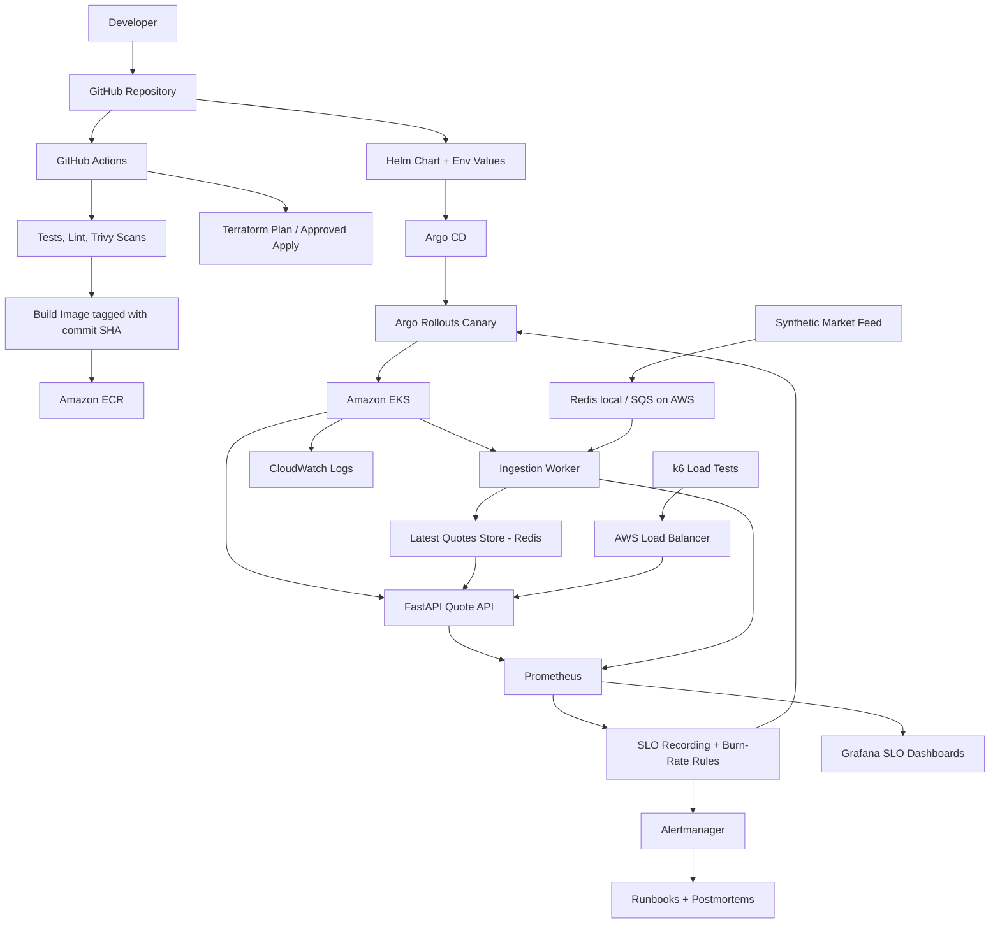

# MarketPulse — SLO-Driven Reliability Platform on AWS

> **Project type:** Portfolio / learning project
> **Target roles:** Site Reliability Engineer (SRE), DevOps Engineer, Cloud Engineer
> **Cloud:** AWS (EKS) — built and validated locally first
> **Status:** Design specification — mark features as implemented only after they are built and tested.
> **Build scope of this file:** **M1–M6 only, fully local, autonomous.** No AWS, no cloud resources, no cost.

MarketPulse simulates a financial market-data service: an API that serves quotes and a worker that ingests market events. The infrastructure is the platform; **the real subject of the project is reliability** — defining what "healthy" means for market data, detecting when it isn't, releasing safely, breaking things on purpose, and recovering with evidence.

It does **not** connect to a real exchange, execute trades, or process real financial transactions. All data is synthetic.

> **For the project owner — one-time setup before starting:**
>
> 1. Create an **empty public** GitHub repo named `marketpulse` (public so Argo CD on kind can pull from it without credentials). Clone it locally.
> 2. Install on your machine: Docker, kind, kubectl, Helm, k6, uv, Python 3.12+, Git, and the GitHub CLI. Run `gh auth login` so `git push` works without prompts.
> 3. Put this file in the repo as `docs/SPEC.md`.
> 4. Claude Code asks permission before running commands unless you allow them in its settings. For an unattended run, allow the tools listed above plus `git` and `make` (check Claude Code's permission-settings documentation for the current way to do this). Do **not** give it AWS credentials for this build.
> 5. Start Claude Code in the repo folder with this prompt:
>
> *"Read `docs/SPEC.md` completely and follow section 0 exactly. Build M1 through M6 autonomously without asking me anything. Commit and push to origin as described. Stop only when M6 is done or you are genuinely blocked, then give me the final report."*
>
> If the session ends early (usage limits, closed laptop), resume with: *"Read `docs/SPEC.md` and `docs/PROGRESS.md`, then continue the autonomous build from where it stopped."*

---

## 0. Instructions for the AI coding agent

You are building this project from this spec **autonomously**. The project owner will not be available to answer questions until you finish. Read the whole spec before writing code. This section governs **how** you work; sections 1–18 define **what** to build.

### 0.1 Scope of this build

- **Build M1, M2, M3, M4, M5, M6 in order** (section 15). Everything runs locally on Docker and kind.
- **Do not build anything AWS-specific in this run:** no `infra/` directory, no Terraform, no AWS workflows, no ALB or Load Balancer Controller config, no `values-aws-dev.yaml`. Sections 10, 11 (AWS parts), and 16 are **reference for a later phase only**.
- **Exception:** the SQS implementation of `QueueBackend` is part of M1 and is tested **only** with `moto` (in-memory mock). It never contacts real AWS.

### 0.2 Autonomy rules

1. **Do not stop to ask for approval** between milestones. When every acceptance check of a milestone passes, record it, push, and continue to the next.
2. **Decide instead of asking.** When the spec is ambiguous, choose the simplest option consistent with the spec, record it in `docs/DECISIONS.md` (question, options, choice, reason), and continue.
3. **Stop only when genuinely blocked**, meaning one of:
   - a required tool is missing or broken on the machine and cannot be installed without the owner's password or account;
   - an acceptance check still fails after **3 serious fix attempts** and later milestones depend on it;
   - `git push` fails for authentication reasons.
   When blocked, write the problem, what you tried, and the exact error into `docs/PROGRESS.md`, commit and push it if possible, and end with the final report (rule 13).
4. **No cloud, no cost.** Never run `aws`, `terraform`, `eksctl`, or anything that creates resources outside this machine. Never use paid APIs or services. If you find an AWS credential in the environment, do not use it.
5. **Never invent results.** Latency numbers, recovery times, drill outcomes and SLO figures appear in docs only if they came from a run you actually executed on this machine. Use `TBD — not yet measured` otherwise. Never mark a check ✅ that you did not run.
6. **Never commit secrets**, credentials, `.env` files, kubeconfig files or tokens. Create `.gitignore` first in M1. Before **every push**, run a secret scan (`gitleaks detect` or equivalent); if it finds anything, remove it and amend before pushing.
7. **Stay in scope.** Do not add tools from the "Not in v1" list (section 4) or anything not in this spec.
8. **Fix the cause, not the test.** Never delete, skip, or weaken a failing test, rule, or check to make it pass.
9. **Keep `docs/PROGRESS.md` current**: every milestone and acceptance check with ✅ / ❌, the date, and the command used to verify it. This file is how a later session resumes.
10. **Clean up after yourself.** Stop background processes you start; leave the kind cluster running at the end so the owner can inspect it, and say so in the final report.

### 0.3 Git workflow

11. **Commits:** small, one logical change each, conventional messages (`feat(api): ...`, `test(worker): ...`, `chore(helm): ...`, `docs(drills): ...`). Run `make lint` and `make test` before each commit once they exist; do not commit code that fails them.
12. **Pushing:**
    - Work on a branch per milestone: `m1-application`, `m2-local-stack`, `m3-slos`, `m4-kind`, `m5-gitops`, `m6-drills`.
    - Push the branch after each meaningful step so work is never lost.
    - When the milestone passes, merge it into `main` with a fast-forward or merge commit, push `main`, and tag it (`m1-done`, `m2-done`, …).
    - **Never** force-push, rewrite published history, delete branches on the remote, or change repository settings.
    - From M5 on, Argo CD tracks `main` on GitHub. Canary tests in M5 are triggered by committing a values change to `main` and pushing, which is the GitOps flow being demonstrated. Revert the bad change with a normal `git revert` commit, never a force-push.

### 0.4 Final report

13. When M6 is done (or you are blocked), finish with a report containing:
    - which milestones passed, with links to their tags;
    - a table of every acceptance check with ✅ / ❌;
    - measured numbers from M3, M5 and M6 drills;
    - every decision recorded in `docs/DECISIONS.md`;
    - known limitations and anything the owner must do manually (e.g. record the demo video, review postmortems);
    - how to start the stack locally (`make up` and `make kind-up && make deploy-local`).

### 0.5 Versions

Before writing dependency files, look up the **current stable versions** of each tool and library and pin them exactly (Python packages in `pyproject.toml` with a lockfile, Helm chart versions, kind node image, container base images by tag **and** digest). Record the chosen versions in `docs/DECISIONS.md`. Do not rely on versions remembered from training data.

### 0.6 Code conventions

| Area | Convention |
|---|---|
| Language | Python 3.12+ |
| Packaging | `uv` with `pyproject.toml` and `uv.lock` |
| Lint / format | `ruff check` and `ruff format`; zero warnings |
| Types | Type hints on all public functions; `mypy --strict` on `app/` |
| Tests | `pytest`; `fakeredis` for Redis; `moto` for SQS; no network in unit tests |
| Config | Environment variables only, parsed with `pydantic-settings`; every variable documented in `docs/configuration.md` with its default |
| Logging | Structured JSON to stdout: `timestamp`, `level`, `service`, `event`, `request_id` / `event_id`; never log full payloads at INFO |
| Metrics | `prometheus_client`; names, labels and buckets exactly as in section 6 |
| HTTP errors | JSON body `{"error": "<CODE>", "detail": "<text>"}` |
| Containers | Multi-stage Dockerfile, non-root user, read-only root filesystem compatible, `HEALTHCHECK` not used (Kubernetes probes instead) |
| Shell | `bash` with `set -euo pipefail`; pass `shellcheck` |

### 0.7 Fault-injection hooks (required for drills and the canary demo)

Build these into the services from M1. All default to off. Each is read at startup from an environment variable, logged at WARNING when non-default, and exposed as a gauge `fault_injection_active{type}` so dashboards show when a fault is on.

| Variable | Service | Effect |
|---|---|---|
| `FAULT_API_ERROR_RATE` | API | Fraction (0–1) of quote requests that return `500` |
| `FAULT_API_EXTRA_LATENCY_MS` | API | Added delay per quote request |
| `FAULT_WORKER_FAIL_RATE` | Worker | Fraction of events that raise during processing |
| `FAULT_WORKER_EXTRA_LATENCY_MS` | Worker | Added delay per event |
| `FAULT_READINESS_FAIL` | API | `/health/ready` returns `503` when `true` |

The "bad version" for the canary demo is the normal image deployed with `FAULT_API_ERROR_RATE=0.2`. Changing the env var changes the pod template, which triggers a new canary.

### 0.8 Makefile targets (create in M1, extend each milestone)

```text
make setup        # install tools/deps into the local environment
make lint         # ruff, mypy, shellcheck, helm lint, terraform fmt -check, tflint
make test         # unit tests with coverage report
make up / down    # docker compose stack
make smoke        # smoke tests against the running stack (compose or kind)
make rules-test   # promtool check rules + promtool test rules
make kind-up / kind-down
make deploy-local # helm install/upgrade onto kind
make load         # k6 steady load
make burst        # k6 market-open burst
make drill N=<n>  # run reliability experiment n from section 9
```

Automated acceptance checks in section 15 must be runnable through these targets. Anything that genuinely needs a person (e.g. recording a video) is listed as a manual step in `docs/PROGRESS.md` with the exact commands to run.

---

## 1. What makes this project different

Most DevOps portfolios stop at "deployed to Kubernetes with dashboards". MarketPulse goes further:

| Typical project | MarketPulse |
|---|---|
| Uptime / HTTP 200 checks | **Domain SLIs**: quote freshness and ingestion lag, not just availability |
| Static threshold alerts | **Multi-window, multi-burn-rate SLO alerts** |
| Manual rollback | **Canary releases with automated, metrics-based rollback** (Argo Rollouts) |
| Kill a pod, watch it restart | **Dependency, node and traffic-burst failure drills** with timed detection and recovery |
| "Monitoring set up" | **Written postmortems** with timelines, evidence and follow-ups |
| Flat load test | **Market-open burst simulation** (09:15 IST traffic spike) |

## 2. Goals

- Define SLIs that reflect what users of market data actually care about: correctness, freshness, latency.
- Alert on error-budget burn, not on raw thresholds.
- Release changes progressively and roll back automatically when SLIs degrade.
- Run controlled failure experiments and measure detection and recovery times.
- Provision repeatable AWS infrastructure with Terraform and deploy via GitOps.
- Produce evidence: dashboards, drill results, postmortems, measured numbers.

## 3. Architecture



### Data flow

1. A **synthetic feed producer** publishes market events (symbol, price, event timestamp) to a queue.
2. The **ingestion worker** consumes events, validates them, and writes the latest quote per symbol to the store.
3. The **quote API** serves the latest quote along with its age.
4. Prometheus scrapes both services; SLO recording rules compute SLIs and burn rates.
5. Burn-rate alerts go to Alertmanager; the same metrics drive canary analysis in Argo Rollouts.

## 4. Technology stack

| Area | Technologies |
|---|---|
| Application | Python, FastAPI, pytest |
| Queue / store | Redis (local and MVP); SQS as the AWS queue extension |
| Containers | Docker, Docker Compose |
| Local Kubernetes | kind |
| Cloud | Amazon EKS, VPC, IAM, ECR, ALB, S3, CloudWatch |
| IaC | Terraform |
| Packaging | Helm |
| GitOps & delivery | Argo CD, Argo Rollouts |
| CI | GitHub Actions with GitHub OIDC federation |
| Observability | Prometheus, Grafana, Alertmanager |
| Security | Trivy, IAM least privilege, Kubernetes RBAC, NetworkPolicies |
| Load testing | k6 |
| Reliability practice | SLOs, error budgets, runbooks, postmortems |

**Not in v1:** OpenTelemetry tracing, Karpenter, service mesh, chaos frameworks. Add only after the MVP works end to end.

## 5. Services

### Quote API (FastAPI)

- `GET /health/live` — process is alive.
- `GET /health/ready` — process has started and loaded config. **Deliberately does not check Redis** (see below).
- `GET /metrics` — Prometheus metrics.
- `GET /v1/quotes/{symbol}` — latest quote plus `age_seconds` and `stale` flag.
- `POST /v1/events` — accept a synthetic market event (for testing).

Required metrics (full definitions and buckets in section 6):

- `http_requests_total{route, method, status}`
- `http_request_duration_seconds{route}` (histogram)
- `quote_age_seconds` (histogram)
- `quote_store_up` (gauge, 1/0, updated on every store call)
- `quote_responses_total{source}` — `source` is `store`, `local_cache` or `unavailable`

### Degraded mode: where the cached quote comes from

Redis is the source of truth for latest quotes. Each API pod also keeps a **deliberately designed in-process cache**:

| Property | Design |
|---|---|
| Location | In-memory dict inside each API process (bounded LRU) |
| Populated | On every successful read from Redis (write-through on read) |
| Size | Max one entry per configured symbol; bounded so memory can't grow |
| Max serving age | `STALE_QUOTE_MAX_AGE_SECONDS`, default **30 s**, measured from the quote's event timestamp |
| Used when | A Redis call fails or times out (Redis call timeout: 50 ms) |

Request behaviour:

1. Redis healthy → serve from Redis, refresh local cache, `stale: false`.
2. Redis unavailable **and** a local entry exists with age ≤ 30 s → `200`, `stale: true`, `source=local_cache`.
3. Redis unavailable **and** no entry, or entry older than 30 s → **`503`** with body `{"error": "QUOTE_UNAVAILABLE"}` and a `Retry-After` header. The API never serves an arbitrarily old price.

**Documented limitations** (put these in `docs/slos.md` and the Redis-outage runbook):

- The cache is **per pod**, not shared. Two pods may return different stale values, or one may return 200 while another returns 503.
- It is **lost on restart**. A pod started during a Redis outage has an empty cache and returns 503 for every quote.
- It only holds symbols that pod has served recently. Rarely requested symbols will likely 503.
- After 30 s of outage, every pod returns 503. Degraded mode buys time; it is not a replacement for Redis.

**Why readiness ignores Redis:** if `/health/ready` failed whenever Redis was down, every pod would be pulled out of the load balancer at once. Degraded mode would never be reached, and users would get load-balancer errors instead of controlled responses. Redis health is instead tracked by `quote_store_up` and alerted on separately.

### Ingestion worker

- Consumes events from the queue; processing is idempotent (keyed on event ID).
- Bounded retries with backoff; after N failures, moves the message to a dead-letter queue.
- Metrics: `events_processed_total{result}` (`result` = `ok`, `retried`, `dead_lettered`), `ingestion_lag_seconds` (histogram), `queue_depth`, `dlq_depth`, `queue_oldest_event_age_seconds` (gauge). Definitions in section 6.

### Queue architecture: Redis locally, SQS on AWS

The worker and producer talk to a `QueueBackend` interface with two implementations, selected by the `QUEUE_BACKEND` environment variable. Business logic (validation, idempotency, writing quotes) is identical in both.

| | Local (`QUEUE_BACKEND=redis`) | AWS (`QUEUE_BACKEND=sqs`) |
|---|---|---|
| Main queue | Redis Stream `events`, consumer group `workers` | SQS **standard** queue `marketpulse-dev-events` |
| DLQ | Redis Stream `events-dlq` | SQS queue `marketpulse-dev-events-dlq` |
| Retry tracking | Delivery count from `XPENDING` | `ApproximateReceiveCount` message attribute |
| Retry backoff | Reclaim with `XAUTOCLAIM` after min idle time | `ChangeMessageVisibility` with growing timeout |
| Ack | `XACK` | `DeleteMessage` |
| Quote store | Redis | Redis (in-cluster for dev; ElastiCache is an optional extension) |

**Delivery semantics (both backends):** at-least-once, possibly out of order. The worker therefore:

- deduplicates on `event_id` (Redis `SET NX` with a TTL), and
- writes a quote only if its event timestamp is newer than the stored one (last-write-wins by event time), so a late duplicate can't overwrite a fresher price.

A FIFO queue is not used; ordering per symbol is enforced by the timestamp check instead, which keeps throughput higher and the design simpler.

**Dead-lettering: two layers on SQS.**

1. **Worker-managed (primary).** After 5 failed attempts (`ApproximateReceiveCount ≥ 5`), the worker sends the message to the DLQ with failure-reason attributes, deletes the original, and increments `events_processed_total{result="dead_lettered"}`. This matches the Redis path exactly, so the ingestion-lag SLI counts these events in both environments.
2. **SQS redrive policy (backstop).** `maxReceiveCount = 10`. This catches messages that crash the worker before it can dead-letter them (e.g. a payload that kills the process). These are **not** counted by the worker counter, so DLQ depth is alerted on separately.

**SQS settings (Terraform):**

| Setting | Main queue | DLQ |
|---|---|---|
| Visibility timeout | 30 s (well above p99 processing time) | — |
| Long polling (`receive_wait_time_seconds`) | 20 s | — |
| Message retention | 4 days | 14 days |
| Encryption | SSE-SQS (no KMS permissions needed) | SSE-SQS |
| Redrive | `redrive_policy` → DLQ, `maxReceiveCount = 10` | `redrive_allow_policy` allows only the main queue |

**IAM (EKS Pod Identity or IRSA), scoped to these two queue ARNs:**

- Worker: `sqs:ReceiveMessage`, `DeleteMessage`, `ChangeMessageVisibility`, `GetQueueAttributes` on main; `sqs:SendMessage`, `GetQueueAttributes` on DLQ.
- Producer: `sqs:SendMessage` on main only.
- Operators (runbook): `sqs:StartMessageMoveTask` to redrive DLQ messages back after a fix.

**Wiring to the worker:** queue URLs are Terraform outputs. They are not secret, so they are committed to `deploy/helm/values-aws-dev.yaml` as `queue.backend: sqs`, `queue.url`, `queue.dlqUrl`. Argo CD deploys them as environment variables. No AWS credentials appear in Git or the image.

**Queue metrics on AWS:**

- `queue_depth`, `dlq_depth`: the worker polls `GetQueueAttributes` (`ApproximateNumberOfMessages`) every 15 s and exports gauges.
- `queue_oldest_event_age_seconds`: SQS only exposes `ApproximateAgeOfOldestMessage` as a CloudWatch metric, so it is pulled into Prometheus with the CloudWatch exporter (YACE). SQS metrics are approximate and arrive with a delay of about a minute; the stall alert's 2-minute `for` accounts for this.
- Extension: replace CPU-based worker HPA with a KEDA SQS scaler on queue depth.

### Synthetic feed producer

- Publishes events for a fixed set of symbols at a configurable rate.
- Supports a **burst mode** that simulates the 09:15 IST market open (e.g. 10× normal rate for 5 minutes).

## 6. SLOs and error budgets

These are **project targets**, not claims of achieved reliability. Window: rolling 30 days (shorter windows acceptable for demos, stated explicitly).

| SLI | Definition | Target |
|---|---|---|
| Availability | Non-5xx responses ÷ all responses on `/v1/quotes/*` | 99.9% |
| Latency | Quote requests served in < 250 ms ÷ all quote requests | 99% |
| **Freshness** | Quotes served with `age_seconds` < 2 ÷ all quotes served | 99% |
| **Ingestion lag** | Events processed within 1 s of event timestamp ÷ all events | 99% |

Rules:

- Health checks, `/metrics`, and k6 traffic tagged as synthetic warm-up are excluded from SLIs.
- Error budget = 1 − target. Document what happens when it's exhausted (e.g. freeze feature releases, prioritise reliability fixes).
- `route` labels use the route template (`/v1/quotes/{symbol}`), never the raw path, to keep label cardinality bounded.

### Histogram buckets

A threshold can only be measured exactly if it is a bucket boundary. Each SLO threshold below is an explicit `le` value. **If a target changes, the bucket list must change in the same commit.**

| Metric | Buckets (seconds) | SLO boundary |
|---|---|---|
| `http_request_duration_seconds` | 0.005, 0.01, 0.025, 0.05, 0.1, **0.25**, 0.5, 1, 2.5, 5 | `le="0.25"` |
| `quote_age_seconds` | 0.1, 0.25, 0.5, 1, **2**, 5, 10, 30, 60 | `le="2"` |
| `ingestion_lag_seconds` | 0.05, 0.1, 0.25, 0.5, **1**, 2, 5, 10, 30 | `le="1"` |

### Where each metric is observed

- `http_request_duration_seconds`: every request to `/v1/quotes/{symbol}`, any status, measured in middleware from request receipt to response sent.
- `quote_age_seconds`: every quote **returned** (`200`), from Redis or local cache. Value = response time − quote's event timestamp. `503` responses record no age; they are captured by the availability SLI.
- `ingestion_lag_seconds`: every event the worker **successfully** writes. Value = write time − event timestamp. Producer and worker run on hosts synced via NTP; skew is a documented limitation.

### Good-event and total-event definitions

`Q` below is shorthand for the selector `route="/v1/quotes/{symbol}"`; `[w]` is the window.

**Availability** — server errors are bad; client errors (e.g. `404` unknown symbol) are good, since they're not a service fault.

```promql
good:  sum(rate(http_requests_total{Q, status!~"5.."}[w]))
total: sum(rate(http_requests_total{Q}[w]))
```

**Latency** — requests answered within 250 ms. All statuses count, so a fast `503` is still "fast" here but bad for availability.

```promql
good:  sum(rate(http_request_duration_seconds_bucket{Q, le="0.25"}[w]))
total: sum(rate(http_request_duration_seconds_count{Q}[w]))
```

**Freshness** — returned quotes that were under 2 s old. Stale local-cache quotes (age > 2 s) count as bad.

```promql
good:  sum(rate(quote_age_seconds_bucket{le="2"}[w]))
total: sum(rate(quote_age_seconds_count[w]))
```

**Ingestion lag** — events processed within 1 s. Dead-lettered events never get a lag observation, so they are added to the total explicitly as bad events.

```promql
good:  sum(rate(ingestion_lag_seconds_bucket{le="1"}[w]))
total: sum(rate(ingestion_lag_seconds_count[w]))
     + sum(rate(events_processed_total{result="dead_lettered"}[w]))
```

### Gaps a ratio SLI can't see — covered by extra alerts

| Gap | Why the ratio misses it | Extra alert |
|---|---|---|
| Worker stalled completely | No events processed → total = 0 → ratio is empty, no burn-rate alert fires | `queue_oldest_event_age_seconds > 10` for 2 m |
| No quote traffic at all | No requests → total = 0 | `absent(http_requests_total{Q})` or k6/blackbox probe failing |
| Redis down while cache still serves | Availability stays good for up to 30 s | `quote_store_up == 0` for 1 m (warning) |

### Recording rules (pattern)

For each SLI and each window `w ∈ {5m, 30m, 1h, 6h, 3d}`:

```yaml
groups:
  - name: slo-availability
    rules:
      - record: sli:availability:error_ratio_rate5m
        expr: |
          1 - (
            sum(rate(http_requests_total{route="/v1/quotes/{symbol}", status!~"5.."}[5m]))
            /
            sum(rate(http_requests_total{route="/v1/quotes/{symbol}"}[5m]))
          )
      # repeat for 30m, 1h, 6h, 3d
```

Burn rate = error ratio ÷ (1 − target). Example fast-burn page for availability (target 99.9%, budget 0.001):

```yaml
      - alert: AvailabilityFastBurn
        expr: |
          sli:availability:error_ratio_rate1h > (14.4 * 0.001)
          and
          sli:availability:error_ratio_rate5m > (14.4 * 0.001)
        labels:
          severity: page
        annotations:
          runbook_url: docs/runbooks/availability-burn.md
```

Freshness, latency and ingestion lag use the same pattern with budget `0.01`.

**Validation (part of M3):** write unit tests for every recording and alerting rule with `promtool test rules`, feeding synthetic series that should and should not fire.

### Burn-rate alerting

Use multi-window, multi-burn-rate alerts (Google SRE Workbook approach) for each SLO, against a 30-day window:

| Severity | Long window | Short window | Burn rate | Budget consumed |
|---|---|---|---|---|
| Page | 1 h | 5 m | 14.4× | 2% |
| Page | 6 h | 30 m | 6× | 5% |
| Ticket | 3 d | 6 h | 1× | 10% |

Implement as Prometheus recording rules named `sli:<sli>:error_ratio_rate<w>` (`<sli>` ∈ `availability`, `latency`, `freshness`, `ingestion_lag`; `<w>` ∈ `5m`, `30m`, `1h`, `6h`, `3d`), plus alerting rules named `<Sli>FastBurn` (1h/5m and 6h/30m pairs, severity `page`) and `<Sli>SlowBurn` (3d/6h, severity `ticket`). Every alert links to a runbook.

## 7. Kubernetes requirements (Helm chart)

- Argo Rollouts `Rollout` for the API (canary); `Deployment` for the worker.
- Readiness, liveness and startup probes.
- CPU and memory requests and limits.
- HPA for the API (CPU) and worker (queue depth via custom metric, as an extension).
- PodDisruptionBudgets for multi-replica workloads.
- Topology spread constraints across nodes / AZs.
- Least-privilege service accounts; secrets never committed to Git.
- NetworkPolicies: only the API and worker may reach Redis.

## 8. Progressive delivery

Canary strategy for the API via Argo Rollouts, with real traffic splitting at the load balancer (not just replica ratios).

### Traffic routers per environment

| | Local (kind) | AWS (EKS) |
|---|---|---|
| Ingress | ingress-nginx | AWS Load Balancer Controller → ALB |
| Rollouts traffic routing | `trafficRouting.nginx` | `trafficRouting.alb` |
| How weights are applied | Rollouts creates a canary Ingress with `canary-weight` annotation | Rollouts writes a weighted-forward action annotation onto the Ingress; the controller updates ALB listener rules across two target groups |

The `AnalysisTemplate` and canary steps are identical in both; only the `trafficRouting` block differs, set via Helm values.

### AWS prerequisites

- **AWS Load Balancer Controller** installed by Argo CD (Helm chart), with an IAM role from Terraform via Pod Identity / IRSA.
- **Subnet tags** in the networking module: public subnets `kubernetes.io/role/elb = 1`.
- **Target type `ip`** on the Ingress (`alb.ingress.kubernetes.io/target-type: ip`), so each Service gets a target group that points directly at its pods.
- **Weight verification:** run the Rollouts controller with `--aws-verify-target-group` and grant it read-only `elasticloadbalancing:Describe*` permissions. Rollouts then confirms the ALB actually applied each weight before moving on, instead of assuming it did.

### Kubernetes objects

```text
Service  marketpulse-api-stable   ← Rollouts points this at stable pods
Service  marketpulse-api-canary   ← Rollouts points this at canary pods
Service  marketpulse-api-root     ← selects all API pods (ALB action target)
Ingress  marketpulse-api          ← backend: marketpulse-api-root, port name "use-annotation"
Rollout  marketpulse-api
```

```yaml
# Rollout (excerpt)
strategy:
  canary:
    stableService: marketpulse-api-stable
    canaryService: marketpulse-api-canary
    canaryMetadata:
      labels: { role: canary }
    stableMetadata:
      labels: { role: stable }
    trafficRouting:
      alb:
        ingress: marketpulse-api
        rootService: marketpulse-api-root
        servicePort: 80
    steps:
      - setWeight: 10
      - pause: { duration: 5m }
      - analysis: { templates: [{ templateName: api-canary-health }] }
      - setWeight: 50
      - pause: { duration: 5m }
      - analysis: { templates: [{ templateName: api-canary-health }] }
```

### Analysis that compares the right pods

Prometheus must be able to tell canary metrics from stable ones. The `role` pod label (set by `canaryMetadata`/`stableMetadata`) is copied onto every scraped series with a relabel rule (`__meta_kubernetes_pod_label_role` → `role`).

```yaml
# AnalysisTemplate api-canary-health (excerpt)
metrics:
  - name: canary-error-ratio
    interval: 1m
    count: 5
    failureLimit: 1
    successCondition: len(result) > 0 && !isNaN(result[0]) && result[0] < 0.01
    provider:
      prometheus:
        query: |
          sum(rate(http_requests_total{route="/v1/quotes/{symbol}", role="canary", status=~"5.."}[2m]))
          /
          sum(rate(http_requests_total{route="/v1/quotes/{symbol}", role="canary"}[2m]))
  - name: canary-latency-good-ratio
    # share of canary requests under 250 ms must stay ≥ 0.99 (same buckets as the SLO)
```

**Minimum traffic:** at 10% weight with little traffic, the canary may get no requests and the query returns no data. During every rollout demo, run a steady k6 load so the analysis has samples. The `successCondition` treats "no data" as a failure rather than a pass, so an untested canary is never promoted.

### What happens on failure

1. Analysis fails → Rollouts **aborts**.
2. Traffic weight returns to 0% canary; the ALB listener forwards 100% to the stable target group (verified via target-group checks).
3. Canary pods scale down after `abortScaleDownDelaySeconds` (default 30 s).
4. The Rollout is marked `Degraded`; Argo CD shows the app as degraded.
5. **GitOps follow-up:** Git still contains the bad image tag. Revert that commit so Git matches what is running; the runbook records this step. The rollback time measured in experiment 3 is from analysis failure to 100% stable traffic.

Demonstrate with a deliberately bad image (e.g. one that returns 5xx on 20% of requests).

## 9. Reliability experiments

Run all experiments in a disposable environment. For each one, record: hypothesis, setup, impact, **time to detect**, **time to recover**, evidence (dashboard screenshots, alert timestamps), root cause, follow-up actions.

| # | Experiment | Expected outcome |
|---|---|---|
| 1 | Kill API pods | Replaced; no SLO breach with ≥2 replicas |
| 2 | Fail readiness on one pod | Traffic stops reaching it; no user errors |
| 3 | Deploy bad version | Canary analysis fails; automatic rollback |
| 4 | **Stop Redis** | `quote_store_up` alert fires; pods serve cached quotes (`stale: true`) for ≤ 30 s, then `503 QUOTE_UNAVAILABLE`; freshness and availability burn; pods stay in the load balancer; full recovery after restore. Also restart one API pod mid-outage to confirm the documented cold-cache limitation. |
| 5 | **Market-open burst** (09:15 simulation) | HPA scales; measure lag spike and drain time |
| 6 | **Poison messages** in queue | Bounded retries; messages land in DLQ; worker stays healthy |
| 7 | **Drain a node** (EKS) | PDBs respected; workloads reschedule |
| 8 | Slow worker (injected latency) | Ingestion-lag burn-rate alert fires within target |

Write **at least three full postmortems** from these (blameless format) in `docs/incidents/`.

## 10. AWS infrastructure (Terraform) — later phase, reference only

```text
infra/
├── bootstrap/              # S3 state bucket (+ locking); applied once, local state
│   ├── main.tf
│   ├── variables.tf
│   └── outputs.tf
├── modules/                # reusable building blocks; never applied directly
│   ├── networking/         # VPC, subnets, routes, NAT, security groups
│   │   ├── main.tf
│   │   ├── variables.tf
│   │   └── outputs.tf
│   ├── eks/                # cluster, managed node group, add-ons
│   ├── ecr/                # repository, scanning, immutable tags
│   ├── queue/              # SQS main queue + DLQ, redrive policies
│   └── iam/                # GitHub OIDC, worker/producer SQS, LB controller roles
└── environments/           # root modules; this is where you run terraform
    └── dev/
        ├── backend.tf      # points at the bootstrap S3 bucket
        ├── main.tf         # calls ../../modules/*
        ├── variables.tf
        └── terraform.tfvars
```

`eks/`, `ecr/`, `queue/` and `iam/` follow the same three-file layout as `networking/`. Commands run only from `infra/bootstrap/` (once) and `infra/environments/dev/`.

- VPC with public and private subnets across 2 AZs.
- EKS cluster with a small managed node group.
- ECR repository with image scanning and immutable tags.
- IAM roles for GitHub OIDC (CI) and IRSA / EKS Pod Identity (workloads).
- Remote state in S3 with encryption and versioning.

**Cost controls for dev:** single NAT gateway (or VPC endpoints), smallest viable node instance types, short sessions, `terraform destroy` after every session.

## 11. CI/CD and GitOps — AWS parts are later phase; local GitOps is M5

**On pull request:** lint, unit tests, build image, Trivy scan, `helm lint` / template validation, `terraform fmt` + `validate` + `plan`.

**On merge to main:** build and tag image with commit SHA → push to ECR → update image tag in the Git values file → Argo CD syncs → Argo Rollouts runs the canary → post-deploy smoke test.

- GitHub OIDC only; no long-lived AWS keys.
- Pull-request workflows get no deploy credentials.
- Demonstrate Argo CD drift detection (manual `kubectl edit` gets reverted).

## 12. Observability

Grafana dashboards:

1. **SLO overview**: each SLI vs target, remaining error budget, burn rate.
2. **API**: request rate, error rate, latency percentiles, stale-response rate.
3. **Ingestion**: event rate, lag percentiles, queue depth, DLQ depth, retries.
4. **Platform**: pod restarts, unavailable replicas, CPU and memory, HPA desired vs current.
5. Deployment and incident annotations on all dashboards.

CloudWatch holds container logs and AWS service telemetry on EKS; Prometheus and Grafana hold application metrics.

## 13. Security baseline

- Short-lived credentials everywhere (OIDC, IRSA / Pod Identity).
- Least-privilege IAM and Kubernetes RBAC.
- Trivy scans in CI; fail on critical vulnerabilities.
- Non-root containers, read-only root filesystem where possible.
- No secrets in Git or image layers.
- NetworkPolicies restricting pod-to-pod traffic.
- Document threat assumptions in `docs/threat-model.md`.

## 14. Repository structure

```text
marketpulse/
├── app/
│   ├── api/
│   ├── worker/
│   ├── producer/
│   └── common/
├── tests/
│   ├── unit/
│   └── smoke/
├── deploy/
│   ├── helm/
│   └── argocd/
├── observability/
│   ├── prometheus/      # recording + alerting rules
│   ├── alertmanager/
│   └── grafana/         # dashboards as JSON
├── infra/              # later phase only — do not create in this build
├── load-tests/          # k6 scripts, incl. market-open burst
├── docs/
│   ├── slos.md
│   ├── runbooks/
│   ├── incidents/       # postmortems
│   ├── experiments/     # drill results
│   └── threat-model.md
├── .github/workflows/
├── docker-compose.yml
├── Makefile
└── README.md
```

Don't create empty directories just to make the repo look bigger.

## 15. Milestones

Each milestone lists **deliverables** and **acceptance checks**. A milestone is done only when every check passes and is recorded in `docs/PROGRESS.md`. Then merge, push, tag and **continue to the next milestone** (section 0.2, rule 1).

### M1 — Application

Deliverables:
- `.gitignore` (first commit), repository skeleton, `pyproject.toml` + `uv.lock`, `Makefile` (section 0.8), `docs/PROGRESS.md`, `docs/DECISIONS.md`, `docs/configuration.md`.
- Quote API, ingestion worker and producer as specified in section 5, including degraded mode, the `QueueBackend` interface with **both** Redis and SQS implementations, and fault-injection hooks (section 0.7).
- All metrics from sections 5 and 6 with the exact names, labels and buckets.
- Multi-stage `Dockerfile` (one image; the service to run is chosen by command).
- `.github/workflows/ci.yml`: on push and pull request, run `make lint`, `make test` and `docker build`. **No AWS steps, no secrets.**

Acceptance checks:
- [ ] `make lint` passes with zero warnings (ruff, mypy `--strict`, shellcheck).
- [ ] `make test` passes; line coverage of `app/` ≥ 80%.
- [ ] Unit tests exist for every one of these behaviours:
  - quote served from Redis → `200`, `stale: false`, cache refreshed
  - Redis down, cached entry ≤ 30 s → `200`, `stale: true`
  - Redis down, no entry or entry > 30 s → `503 QUOTE_UNAVAILABLE` with `Retry-After`
  - `/health/ready` returns `200` while Redis is down
  - duplicate `event_id` processed once
  - older event does not overwrite a newer stored quote
  - event dead-lettered after 5 failed attempts and counted as `dead_lettered` (Redis backend, and SQS backend via `moto` only)
  - each fault-injection variable changes behaviour and sets `fault_injection_active`
  - `/metrics` exposes every required metric, and histogram buckets include `0.25`, `2` and `1` on the right metrics
- [ ] `docker build` succeeds; the container runs as a non-root user.
- [ ] The CI workflow passes on GitHub for the pushed `main` (check with `gh run list` / `gh run view`).

### M2 — Local stack

Deliverables:
- `docker-compose.yml` with api, worker, producer, redis, prometheus, grafana, alertmanager.
- Prometheus scrape config; Grafana datasource and dashboards provisioned from files (no manual clicking).
- `tests/smoke/` smoke tests.

Acceptance checks:
- [ ] `make up` brings every container to healthy within 2 minutes.
- [ ] `make smoke` passes: health endpoints return `200`, a produced event appears as a quote within 5 s, `/metrics` is reachable.
- [ ] Every Prometheus target shows `up == 1` (checked via the Prometheus HTTP API).
- [ ] Grafana's API lists the provisioned API and Ingestion dashboards, and their queries return data (checked via the Grafana and Prometheus HTTP APIs).
- [ ] `make down` removes everything; a second `make up` works again.

### M3 — SLOs and alerting

Deliverables:
- Recording rules for all four SLIs × five windows; burn-rate alerting rules (section 6); the three gap alerts.
- `promtool` unit tests in `observability/prometheus/tests/`.
- SLO overview dashboard; runbooks in `docs/runbooks/`, one per alert; `docs/slos.md` including the degraded-mode limitations.

Acceptance checks:
- [ ] `make rules-test` passes: `promtool check rules` and `promtool test rules`.
- [ ] Rule tests cover, for each SLI, at least one case that **must fire** and one that **must not fire**.
- [ ] Every alert has a `runbook_url` that points to a file that exists.
- [ ] Live check: with the stack running and `make load`, setting `FAULT_API_ERROR_RATE=0.2` makes `AvailabilityFastBurn` fire (checked via the Alertmanager API); clearing it resolves the alert. Record both timestamps.
- [ ] Live check: stopping the worker fires the stall alert.

### M4 — Local Kubernetes

Deliverables:
- `scripts/kind-up.sh`: multi-node kind cluster (1 control plane + 2 workers) with a CNI that **enforces** NetworkPolicies (e.g. Calico), metrics-server, ingress-nginx, and kube-prometheus-stack (or equivalent) loading the same rules and dashboards. `scripts/kind-down.sh` deletes it.
- Helm chart in `deploy/helm/marketpulse` with `values-kind.yaml`. Images are built locally and loaded with `kind load docker-image`; no registry push.

Acceptance checks:
- [ ] `helm lint` and `helm template | kubeconform -strict` pass.
- [ ] `make kind-up && make deploy-local` deploys everything; all pods `Ready`.
- [ ] `make smoke` passes against the kind ingress.
- [ ] Containers run non-root with resource requests and limits set (verify with `kubectl get pod -o yaml`).
- [ ] A test pod outside the allowed set **cannot** connect to Redis; API and worker can.
- [ ] Under `make load`, the API HPA scales up; it scales back down after load stops.
- [ ] Deleting one API pod causes no failed requests in a concurrent k6 run with 2+ replicas.

### M5 — GitOps and progressive delivery (on kind)

Deliverables:
- Argo CD and Argo Rollouts installed by script; Argo CD `Application` manifests in `deploy/argocd/` pointing at this public GitHub repo's `main` branch.
- API converted to a `Rollout` with nginx traffic routing, `AnalysisTemplate` per section 8, Prometheus relabelling for the `role` label.
- Runbook: `docs/runbooks/canary-abort.md`, including the `git revert` step.

Acceptance checks:
- [ ] Argo CD shows the app `Synced` and `Healthy` from GitHub (checked with the `argocd` CLI or `kubectl get application`).
- [ ] A manual `kubectl edit` of a managed resource is reverted by Argo CD (drift detection).
- [ ] A good change (e.g. a harmless env var), committed and pushed to `main`, completes all canary steps and is promoted.
- [ ] A bad change (`FAULT_API_ERROR_RATE=0.2`), pushed to `main` while `make load` runs, fails analysis and is **aborted automatically**; traffic returns to stable. Record the time from analysis failure to 100% stable. Then `git revert` the bad commit and push.
- [ ] With no traffic, the canary is **not** promoted (no-data counts as failure). Revert afterwards.

### M6 — Local drills

Deliverables:
- `scripts/drills/` with one script per experiment (1–6 and 8 from section 9), runnable via `make drill N=<n>`.
- `docs/experiments/<n>-<name>.md` per drill, using a fixed template (hypothesis, setup, steps, expected, observed, time to detect, time to recover, evidence, follow-ups).
- `docs/incidents/TEMPLATE.md` (blameless postmortem template).

Acceptance checks:
- [ ] Each drill script prints start and end timestamps and restores the system when it finishes, even if interrupted (`trap` cleanup).
- [ ] Each drill doc contains numbers from an **actual run**. Evidence = Prometheus query results and Alertmanager alert timestamps exported as JSON or CSV into `docs/experiments/evidence/` (screenshots are optional; the owner can add them later).
- [ ] Drill 4 confirms both degraded-mode phases (stale `200`, then `503`) and the cold-cache limitation.
- [ ] At least two full postmortems are written in `docs/incidents/` from real drill data, marked **"Draft — for owner review"** at the top.
- [ ] A short `README.md` exists: summary, architecture diagram, quick start, a results table filled **only** with measured numbers, and links to SLOs, runbooks, drills and postmortems.

Then write the final report (section 0.4) and stop.

### Later phase (NOT in this build)

For reference only; do not implement in this run.

- **M7 — AWS infrastructure:** Terraform (section 10), SQS (section 5), AWS Load Balancer Controller and ALB routing (section 8). Requires the owner's AWS account and approval for every apply.
- **M8 — AWS CI/CD:** OIDC, ECR publishing, GitOps image updates (section 11).
- **M9 — Cloud drills:** node drain, burst and Redis outage on EKS.
- **M10 — Portfolio polish:** demo video, screenshots, cost and cleanup guide.

## 16. Cost and cleanup — later phase, reference only

- EKS has an hourly control-plane charge; nodes, NAT gateways, load balancers, EBS volumes, logs and data transfer add more. Free tier does not cover EKS.
- Set AWS Budgets alerts (they alert, they don't cap).
- Plan short cloud sessions (a few hours), then `terraform destroy`.
- After teardown, check for leftover load balancers, EBS volumes, Elastic IPs, NAT gateways, and CloudWatch log groups.
- Never destroy the bootstrap state bucket accidentally; keep it in a separate stack.

## 17. Definition of done

Another engineer can:

1. Run the full stack locally with one command.
2. See SLO dashboards with live burn rates.
3. Trigger a bad deploy and watch it roll back automatically.
4. Reproduce a documented failure, follow the runbook, and recover.
5. Read measured results and postmortems.
6. Deploy to and clean up a disposable EKS environment.

## 18. Resume guidance

Write bullets **only after measuring**. Good shape:

- "Defined freshness and ingestion-lag SLIs for a market-data service; implemented multi-window burn-rate alerting that detected injected degradations in X minutes."
- "Built canary releases with Argo Rollouts and Prometheus analysis; bad releases rolled back automatically in Y seconds."
- "Ran N failure drills (dependency outage, node drain, 10× traffic burst) and wrote blameless postmortems with measured detection and recovery times."

Do not claim production use, availability percentages, or cost savings without reproducible evidence.

---

## References

- [Google SRE Workbook — Alerting on SLOs](https://sre.google/workbook/alerting-on-slos/)
- [Google SRE Workbook — Implementing SLOs](https://sre.google/workbook/implementing-slos/)
- [Argo Rollouts](https://argo-rollouts.readthedocs.io/)
- [Argo CD](https://argo-cd.readthedocs.io/)
- [Amazon EKS](https://docs.aws.amazon.com/eks/)
- [Terraform AWS Provider](https://registry.terraform.io/providers/hashicorp/aws/latest/docs)
- [Prometheus](https://prometheus.io/docs/)
- [Grafana](https://grafana.com/docs/)
- [GitHub OIDC with AWS](https://docs.github.com/actions/deployment/security-hardening-your-deployments/configuring-openid-connect-in-amazon-web-services)
- [k6](https://grafana.com/docs/k6/latest/)
- [Trivy](https://trivy.dev/)
